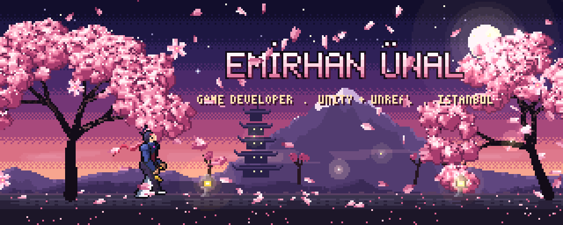
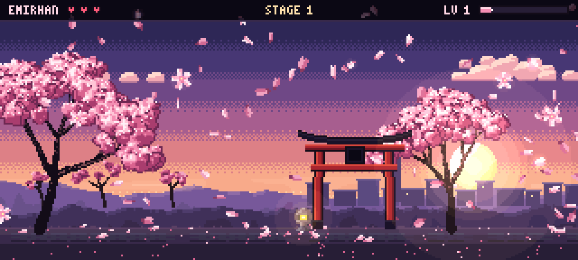
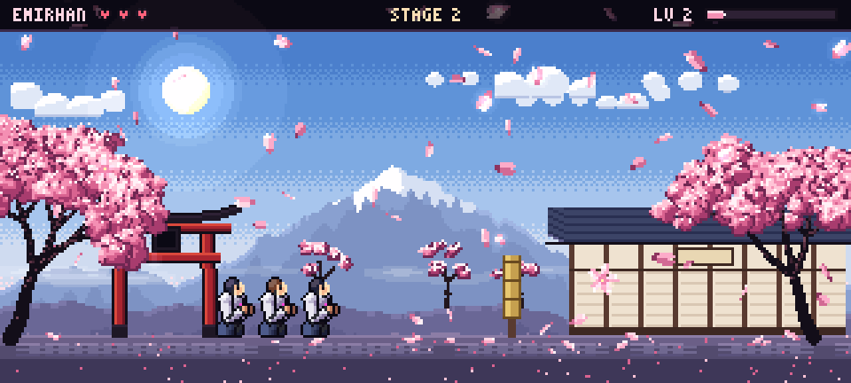
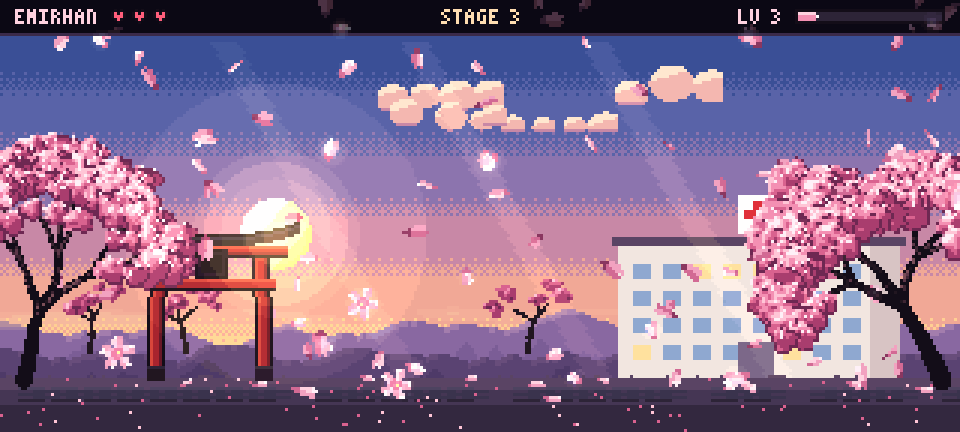
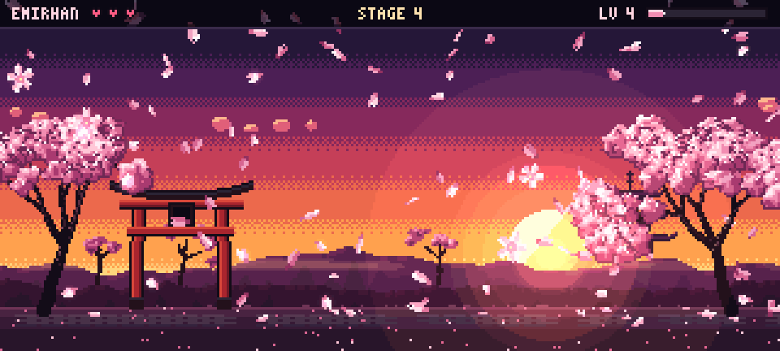
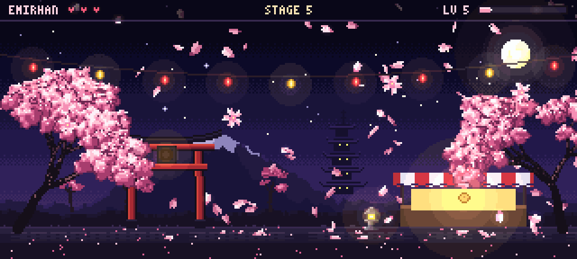

  

  <a href="https://benemirhanunal.github.io/benemirhanunal/"><b>Play Sakura Road</b></a> ·
  <a href="https://store.steampowered.com/app/3989920/TaterUp/">Steam</a> ·
  <a href="https://icarusogt.itch.io/">itch.io</a> ·
  <a href="https://www.linkedin.com/in/benemirhanunal/">LinkedIn</a> ·
  <a href="mailto:emirhan_60unal@hotmail.com">Email</a>

Hi, I'm Emirhan. I make games, mostly in Unity and sometimes in Unreal, and I've been doing it for about six years: a student club, a classroom, a healthcare VR lab, an online shooter, and finally a game of my own on Steam.

Here's that story as a five-stage run. Each stage loops. Or skip the replays and **[play it yourself in the browser ▶](https://benemirhanunal.github.io/benemirhanunal/)**: walk to the marker at each gate, slash the slimes, reach the festival.

 

### Stage 1 · Eskişehir

Studied Computer Engineering at Eskişehir Osmangazi University. There was no place on campus to make games with other people, so I started one. The community grew past 200 developers with jams, workshops and a lot of unfinished prototypes. Some of them got finished.

### Stage 2 · The dojo

Ran a game development training program and taught 100+ students to build their first games. Teaching was the fastest way I found to learn what I didn't actually understand yet.

### Stage 3 · TÜSEB

Built clinical VR simulations for medical training on Meta Quest. VR doesn't forgive a dropped frame, so a lot of the job was profiling: batching draw calls, pooling objects, cutting allocations until the headset stayed smooth.

### Stage 4 · Negentra Games

Worked on an online third-person shooter. Netcode with Photon Fusion, backend on AWS: state sync, lag compensation, and making two players agree on what just happened.

### Stage 5 · TaterUp

My own game, designed, built and shipped. **[TaterUp is on Steam.](https://store.steampowered.com/app/3989920/TaterUp/)**

### Next stage

Right now I'm working in Unity 6 across VR, multiplayer and voice-driven AI characters. If you're building something in that space, or just want to talk games, write to me.

 

**Tools I reach for:** Unity · C# · Unreal Engine 5 · C++ · Photon Fusion · Netcode for GameObjects · Meta Quest · AWS · Steamworks · Blender · Git

 

All the pixel art above is drawn in code, frame by frame, with <a href="https://github.com/patch-gg/pixelfx">pixelfx</a>.
